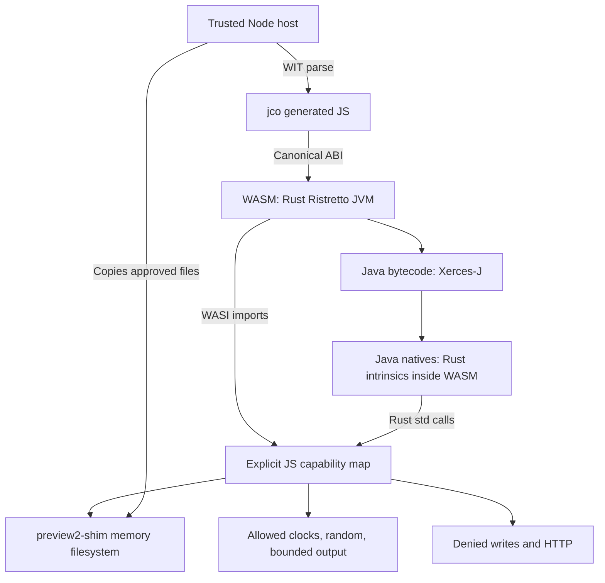

# Sandbox findings

The measurements below describe the original Xerces workload. The Saxon extension adds its JAR and JDK `lib/tzdb.dat` to the mounted runtime; those files and its memory/time costs are not included in the historical measurements. See [README.md](README.md#saxon-he-proof-of-concept) and [Saxon evidence](results/saxon-poc.json).

These findings apply to the pinned component and Node host. Source inspection and negative probes provide evidence, not a complete security audit.

## WASM, JS and native code

Node/V8 runs core WASM. jco implements the component canonical ABI and resource handles, connecting imports to supplied JS objects. Strings/read buffers cross JS/WASM with copies: filesystem byte arrays are not direct Java heap pointers.

Java `native` methods execute Ristretto Rust intrinsics **inside WASM**. They do not automatically invoke JNI, a host `.so`, or Node. Rust `std::fs` reaches WASI, then JS handlers. Node itself uses native OS/V8 implementations for provisioning, clocks and randomness. The restricted host grants no real-disk fallback, launcher or shared-library bridge.

The public Node preview2-shim filesystem performs disk I/O through a worker. Our host imports its pinned internal `browser/index.js` to use synchronous JS byte arrays inside Node. This avoids IPC for tiny JImage reads. Internal APIs require review on dependency upgrades.

### Can JS implement missing Java natives?

Yes, with a bridge: implement a WIT/WASI import in JS and add/modify a Rust Java intrinsic to call it. Existing WASI services can be replaced directly. There is no general JS API here to register arbitrary Java natives by class/name/signature. Java semantics belong in Ristretto's intrinsic registry; host capabilities should be explicit imports.

Bare `wasm32-unknown-unknown` has no WASI filesystem; `wasm32-wasip2` can run in browsers when imports are provided. Browsers cannot provide unrestricted processes, JNI libraries or ordinary TCP sockets. Selected services can use WASI/HTTP or custom imports. Node also cannot automatically fill missing Java semantics: Ristretto's WASM process implementation returns unsupported-operation errors. Native coverage varies by Java version/workload; Xerces DOM works here, complete compatibility is not established.

## Class loading versus application I/O

The bootstrap loader does **not** use Java `java.io.File` to find every class. Ristretto's Rust loader parses/verifies bytes from:

- `/jdk/lib/modules`: Java 21 JImage bootstrap classes/resources.
- `/app/classes`: bridge/probe class files.
- `/app/vendor/*.jar`: Xerces/XML classes/resources.

The directory loader uses Rust `std::fs::read`; JARs are loaded into Rust memory and ZIP entries read there. JImage opens a file: its WASI byte source uses a mutex-protected Rust `File` with many small reads. Java `FileInputStream` and NIO intrinsics also use Rust filesystem operations. **Both reach the same WASI descriptors.** The host cannot reliably distinguish class-loader reads from application reads by caller identity.

Only provisioned bytes are mounted. Host `/etc/passwd` is absent and `HOME` is not supplied. However Java can read `/jdk/release`, deliberately confirmed by the probe. Read-only protection prevents changes without hiding the bytes.

### Can the loader and filesystem be separated?

Yes architecturally, but not completely through this PoC's current policy. Ristretto has `ClassPathEntry::Memory`/`Memory::add_class` and `Jar::from_bytes` for filesystem-free application classes. The memory entry is not a general resource provider. Bootstrap still selects a Java home/version; JImage is file-backed and module/JDK resource initialization needs support. Public configuration does not inject a complete alternative bootstrap provider.

The proposed design uses two independent interfaces:

1. Immutable **artifact provider** for approved classes, JAR resources, JDK modules, metadata and configuration, outside the guest filesystem.
2. **Guest filesystem** for authorized workspace files with rights, quotas and safe descriptor/path resolution.

Java resource APIs may expose approved resources without granting arbitrary file access. Path prefixes do not establish caller privilege. Preloading some classes and revoking files is fragile because loading is lazy. Empty preopens prevent VM boot in our test. Full separation needs bootstrap/JImage/resource API changes, not just another shim mount arrangement.

## Controlling WASI; which operations are required?

All outbound host capabilities use imports. Supply explicit objects and enforce rights, paths, quotas and per-instance state. Resource/stream methods must preserve policy after handles are issued. Initial path/open checks alone are insufficient. jco captures functions during instantiation: deleting an import-object property later does not reliably revoke it. For runtime changes, handlers must consult mutable per-instance policy, and revocation must also cover already-issued handles/streams. This PoC installs a fixed policy.

**Linking and actual use differ.** This build declares 21 WASI interfaces. Generated glue expects their functions/resource classes even on unused branches. Removing `wasi:http/outgoing-handler` fails instantiation, as verified. A deny stub satisfies linking without granting HTTP. Successful XML parsing used 14 distinct operations:

| Interface | Observed operations | Policy |
| --- | --- | --- |
| `filesystem/preopens` | `get-directories` | Provisioned memory root |
| `filesystem/types` | descriptor `open-at`, `stat`, `stat-at`, `metadata-hash`, `metadata-hash-at`, `read-via-stream`, `readlink-at` | Read only; mutations denied; no symlinks |
| `io/streams` | input-stream `read` | Issued handles |
| `cli/environment` | `get-environment` | Empty environment, fixed args/cwd |
| `clocks/monotonic-clock` | `now` | Host time |
| `clocks/wall-clock` | `now` | Host time |
| `random/insecure-seed` | `insecure-seed` | Shim implementation |
| `random/random` | `get-random-u64` | Shim implementation |

Table names have a `wasi:` prefix; calls use version 0.2.12. This is an observed set, not a universal minimum. Clocks serve runtime timing; randomness includes runtime/hash seeds. Preserve cryptographic semantics if changing random APIs; insecure seeds are not cryptographic entropy. Metadata supports Rust file/seek behavior. `readlink-at` is attempted in path resolution and returns an error because no symlinks exist. Preopens/reads are necessary as a group: no preopens breaks bootstrap. We did not individually remove every observed operation.

Other linked interfaces include stdin/stdout/stderr, terminal queries, exit, I/O poll/error, and HTTP types/outgoing-handler. Error paths use output absent from the successful-parse audit. Stdin is closed; output has a combined per-call budget; memory CLI exit throws instead of calling Node `process.exit`. No sockets interface is imported by this component. The report records all declared interfaces, the static operation inventory and phase-specific call counts.

**`enableNetwork: false` is insufficient:** socket denial helpers do not revoke the HTTP handler, which can use host `fetch`. This host denies outgoing-handler explicitly. HTTP remains linked through dependencies although the fixed local Java home avoids runtime downloads. Future JS/native bridges need the same capability review.

## Enforced controls and limitations

`host-policy.mjs` denies twelve descriptor mutation methods and rejects create/truncate/write/mutate-directory in `openAt`. It reports read-only flags. The stock browser shim ignores some descriptor rights and has stub mutators; flags alone do not establish enforcement.

`host.mjs` supplies no ambient environment/disk fallback. It copies one selected XML (or the selected XML and XSLT for transformation) and removes previous inputs. Input must be directly inside the configured directory, opened with `O_NOFOLLOW`, and checked by its opened `/proc/self/fd` target. Allocation is bounded before Java executes, including concurrent growth. Configuring the directory is a trusted host action.

Defaults: 8 MiB per selected XML/XSLT file, 1 MiB combined stdout/stderr per call. All guest writes are denied, including `/tmp`. DOCTYPEs/external entities are disabled to stop XML requesting more files/URLs. Return JSON, DOM and Java heap are **not** bounded by the output budget. Small XML can still exhaust CPU/memory. Those limits are not implemented. Linked random-byte and other handlers also need request-size checks: guest requests can exhaust host allocations independently of WASM heap size.

Verification covers valid/malformed/missing XML, reuse after errors, prohibited DOCTYPE, input quota/directory escape, Java I/O/NIO writes, hidden host files/environment, subprocess/library failures, direct HTTP denial, every mutation stub, omitted-interface linking failure and no-preopen bootstrap failure. The library probe uses a nonexistent path: that failure alone is not an audit. The WASM target and absence of a host library bridge supply the architectural boundary. General escape/resource auditing remains open.

## Filesystem/runtime size

| Measurement | Bytes | Size |
| --- | ---: | ---: |
| JS filesystem file payload | 37,856,943 | 36.10 MiB |
| JDK JImage | 36,089,960 | 34.42 MiB |
| WASM linear memory after parse + Java probe | 65,011,712 | 62.00 MiB |
| Process RSS after parse + Java probe | 235,675,648 | 224.76 MiB |
| Filesystem JS implementation source | 14,481 | 0.01 MiB |
| Filesystem JS source gzip | 3,826 | 0.00 MiB |

Mounted files: 19; selected XML: 202 bytes. Audited cold setup + parse: 10,323 ms; timing is not a performance guarantee.

The uncompressed two-module JDK image dominates; the full downloaded JDK is not mounted. Different jlink module selection/compression may reduce size but needs compatibility testing; module minimality was not established.

Payload excludes directory/descriptor/stream objects, JS heap overhead, bindings and temporary copies. Archive/class/object allocations consume WASM memory too. Node `external` includes WASM and buffers: do not add those totals again. RSS includes V8 compiled code/runtime overhead. Snapshots are after parsing plus a fresh Java probe, not steady-state benchmarks. Each file/exported WASM memory is recorded. Filesystem source size is one module, not the entire shim or JS bundle.

## Toward a QuickJS-style sandbox

The useful boundary is **WASM plus explicit host capabilities**. Guest reflection, `Unsafe` and Rust intrinsics stay inside WASM unless an import grants host access. Guest corruption/denial of service remains possible. Java access checks or SecurityManager are not the host boundary.

Next steps:

1. Separate trusted classes/resources from guest filesystem access.
2. One worker/component/shim realm per tenant. Shim state is module-global; a second parser in the same realm reconfigures it. This API supports sequential experiments, not concurrent tenants.
3. Enforce deadlines outside the blocked worker and terminate it. Same-thread timers cannot interrupt synchronous parsing. Precise budgets need JVM interpreter counters/interruption or a WASM engine with fuel/epoch interruption; this V8 API provides no fuel budget.
4. Set a WASM memory maximum and total resource budget. Worker `resourceLimits` do not fully bound WASM/buffer external memory. This component installs no guest allocation budget. An OS-limited worker process or suitable WASM engine gives stronger bounds.
5. Audit lifetimes, rights, paths, errors, output/return sizes, lazy loading and all bridges. Future writes need a quota-aware filesystem.

Restricted Java workloads look feasible, as Xerces demonstrates. A QuickJS-style arbitrary-code sandbox needs substantial work on interruption, heap limits and loading. Arbitrary Java, DITA-OT and schema processing remain unproven. The next prototype should implement the separate loader and worker deadline/memory policy, then test hostile bytecode and resource-heavy XML.

## Source references

All Ristretto links are pinned:

- [VM bootstrap](https://github.com/theseus-rs/ristretto/blob/dcd45fb452d6956122a9985096260310a22b4d44/ristretto_vm/src/vm.rs)
- [Directory loader](https://github.com/theseus-rs/ristretto/blob/dcd45fb452d6956122a9985096260310a22b4d44/ristretto_classloader/src/class_path_entry/directory.rs)
- [JAR/byte-array loader](https://github.com/theseus-rs/ristretto/blob/dcd45fb452d6956122a9985096260310a22b4d44/ristretto_classloader/src/class_path_entry/jar.rs)
- [Memory classes](https://github.com/theseus-rs/ristretto/blob/dcd45fb452d6956122a9985096260310a22b4d44/ristretto_classloader/src/class_path_entry/memory.rs)
- [JImage loader](https://github.com/theseus-rs/ristretto/blob/dcd45fb452d6956122a9985096260310a22b4d44/ristretto_classloader/src/class_path_entry/image.rs)
- [JImage byte source](https://github.com/theseus-rs/ristretto/blob/dcd45fb452d6956122a9985096260310a22b4d44/ristretto_jimage/src/byte_source.rs)
- [WASM processes](https://github.com/theseus-rs/ristretto/blob/dcd45fb452d6956122a9985096260310a22b4d44/ristretto_intrinsics/src/java/lang/processimpl.rs)
- preview2-shim inspected from pinned npm source: `lib/browser/filesystem.js`, `lib/browser/cli.js`, `lib/browser/http.js`, `lib/instantiation.js`, `lib/nodejs/filesystem.js`.
